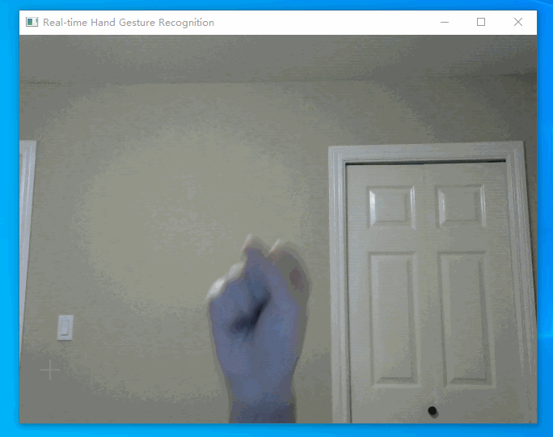
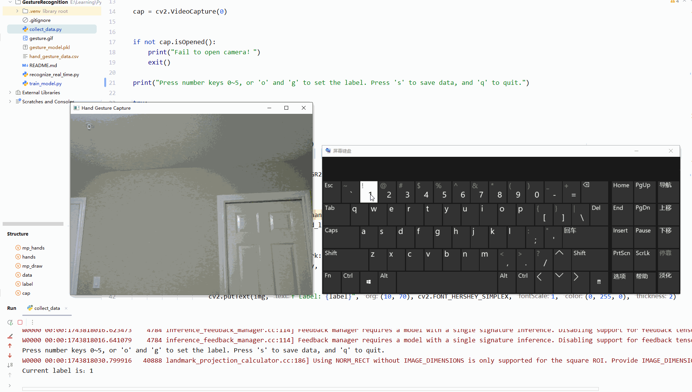

# 🖐️ Real-Time Hand Gesture Recognition with MediaPipe

This project enables real-time hand gesture recognition using a webcam. It uses [MediaPipe](https://mediapipe.dev/) for hand landmark detection and several machine learning classifiers (MLP, KNN, Random Forest, and SVM) for gesture classification.

It supports:
- Numeric gestures: `1`, `2`, `3`, `4`, `5`
- Custom gestures: `👍` (good), `👌` (ok)

## 📸 Demo


---

## 🚀 Features
- Live webcam input using OpenCV
- Hand landmark extraction using MediaPipe (21 keypoints per hand)
- Gesture data collection and CSV saving
- Classification model training (MLP, KNN, Random Forest, SVM)
- Real-time gesture prediction and overlay display
- Easily extendable with more gestures

---

## 📁 Project Structure

```
gesture_project/
├── collect_data.py         # collect gesture
├── train_model.py          # tain model
├── recognize_real_time.py  # Real time recognize
└── README.md               # read me 
```


---

## 🧪 How to Use

### 1. Install Dependencies

```bash
pip install mediapipe opencv-python scikit-learn numpy pandas
```

### 2. Collect Hand Gesture Data

```
python collect_data.py
```

Instructions:

- Press keys `1` to `5` to label number gestures
- Press `g` for 👍 (good)
- Press `o` for 👌 (ok)
- Press `s` to save a frame with the current label
- Press `q` to quit and save the CSV

Each saved frame will store 63 values (21 keypoints × 3D) + 1 label.



### 3. Train the Classifier

```
python train_model.py
```

This will load the CSV file, train four machine learning models (MLP, KNN, Random Forest, and SVM), and save the trained models as .pkl files.

### 4. Real-Time Prediction

```
python recognize_real_time.py
```

Your webcam will open and show predicted gestures live on the screen.


## 📥Other Resources

[Model I trained-KNN](resource/gesture_model_knn.pkl)

[Model I trained-MLP](resource/gesture_model_mlp.pkl)

[Data I collected](resource/gesture_data.csv)

[Hand Gesture Controlled PPT Page Turner Project](https://github.com/chloexj/PPT_page_turn)